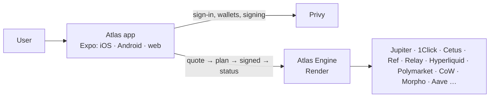

# Atlas

**Your money, one balance, anything on-chain.** Atlas is a money app for people whose salary loses value
while it sits in the bank, Nigerians first. Add naira-worth of dollars once, then buy memes, tokenized
stocks and crypto, open perps, explore predictions, earn yield and pay friends, all from one balance shown in your own currency,
with **one tap to confirm** and no chain names, bridges or gas to think about.

- **Engine (API):** [Iwetan77/Atlas-Engine](https://github.com/Iwetan77/Atlas-Engine), live at
  https://justatlas.xyz
- **This repo:** the client. React Native + Expo (managed workflow), TypeScript, one codebase for iOS,
  Android and web.

Money is shown in the user's selected currency (₦, $, €, £, KSh, GH₵, R). The one balance holds two kinds
of cash: **Spendable** (USDC on Base) for sending, cashing out and saving, and **Trading** (USDC on Solana)
for trades, perps and predictions. Network details are shown only when needed to select a deposit or
withdrawal route.

---

## How it works

1. **Sign in** with Google or email. Privy creates the user's own wallets (EVM and Solana) with no seed
   phrase and no "create wallet" step.
2. **Add money** from the Add money sheet:
   - **Wallet or exchange:** USDC on Base goes straight into Spendable (USDC on Solana goes straight into
     Trading); USDT on Tron or BNB Chain, USDC on Sui, SOL and other supported networks and coins get a
     one-off address with a QR and live status, and land in Spendable.
     Each option shows its coin's logo with the chain as a badge. Type what you want to land in your balance;
     the quote adds fees on top and shows the full amount to send.
   - **Bank transfer:** a one-time Nigerian bank account. Enter the amount you want in your balance;
     the quote shows fees and the full transfer amount before you proceed. It lands in Spendable.
3. **Home** shows the one balance (hide it with the eye: amounts turn into `₦••••`). The chevron under it
   opens its two cash cards, **Spendable** and **Trading**: tap Trading to go to Trade, or Add to move
   money in from Spendable. Below: what's earning, and a card per coin held with its gain or loss,
   shareable as an image.
   - **Move money** moves cash between Spendable and Trading in a few seconds for a few cents, one confirm:
     from Trading's Add, the Trade and Perps cards, or the Spendable card on every Send screen.
4. **Trade:** Trending (the day's biggest risers, per kind), Crypto, Stocks and Memes, plus search by name or
   pasted address on a supported chain. Charts use available venue data; searched assets without a verified
   listing carry an **unverified** warning with their address.
5. **Buy or sell in one tap.** The app gets a live quote (price held for a few seconds, refreshed), the user
   confirms once on the confirm sheet, and the app signs the engine's plan and follows it to the end:
   "Buying…", then done. Buys are paid from Trading; a Base coin's price comes over from Trading inside that
   same confirm. Sales come back to Trading (a Base coin's sale lands in Spendable).
6. **Perps** on Hyperliquid: crypto, stocks, commodities, indices and currencies, long or short with leverage,
   margin from Trading, liquidation price shown before opening, one tap to close, and the money comes back
   to Trading. Pick take-profit and stop-loss when opening, or edit them on a position later.
7. **Earn:** pick a venue (Jupiter Lend, Morpho, Aave, Jito), then what to save in, best rate first; put in
   from Spendable or take out any time.
8. **Withdraw** from Home's Withdraw sheet, the mirror of Add money, each screen showing Spendable on a pink
   card (with what's in Trading and a way to move it over). Everything here is paid from Spendable:
   - **Atlas Friends:** to an @handle, straight to the friend's Spendable.
   - **Atlas Link:** a link anyone can claim on the web, no app needed.
   - **Send to bank:** naira to any Nigerian bank account. Typing an account number suggests matching
     recent recipients with their bank logo, name and account number; recents refresh on returning.
   - **Withdraw to wallet:** paste any address and pick the coin: USDC on Solana or Base, USDT on Tron or BNB
     Chain, SOL, BTC and other supported deposit coins. The amount entered is what the recipient gets;
     the review shows the fees and full cash debit.
     Availability and minimum amounts come from the live route.
9. **The bottom bar:** Home, Trade, Perps, Atlas Predictions (opens the mini app straight away; it's under More's
   mini apps too) and More. Predictions shows live Polymarket events, fee-inclusive minimum spend, outcome
   shares, resolved winnings and cash return, paid from and returned to Trading. Returning cash lands the
   amount entered, with fees added on top.
   The desktop sidebar and Home dashboard also link straight to Predictions and Send money.
10. **Errors speak money:** "Not enough in your trading balance for this. You have ₦12,400 to trade", with
   an **Add money** button that fills in what's missing and moves it from Spendable; a send short in
   Spendable offers **Move from trading** when Trading has money.

---

## What's integrated

| | What it does in the app |
|---|---|
| **Expo SDK 57 + Expo Router** | One codebase for iOS, Android and web; file-based routes in `src/app`. |
| **Privy (Expo and React SDKs)** | Google and email sign-in, the user's embedded wallets, headless signing after the one confirm. |
| **Atlas Engine** | Everything with money in it: balance, quotes, plans, deposits, perps, earn, friends. The app sends the Privy access token on every request. |
| **react-native-qrcode-styled** | Deposit QR codes. |
| **EAS** | Native development and release builds, using the project's signing credentials. |

---

## Safety model

- **Wallet ownership and configuration.** Users sign through their Privy embedded wallets. Provider secrets
  remain on the engine; the app contains only public configuration.
- **One confirm, then only what was confirmed.** The confirm sheet shows the plan in plain words; the app
  signs exactly the engine's plan: transactions, pinned EVM typed data, or one-use Privy device approvals.
  The bridge passes device approvals to Privy; it never signs a user's wallet using their login token.
- **No wallet pop-ups.** Privy's own UIs are off, so the confirm sheet is the only prompt the user answers.
- **Base transactions are relayed, not re-built:** the app hands the planned transaction to the engine,
  which sends it only if it matches the plan byte for byte.
- **Gas is the user's own**, topped up from their USDC when needed; the app never asks Privy to sponsor it.
  Deposits do not automatically collect a Solana gas reserve each time. Swaps first check whether the
  existing SOL can pay their fees and account rent. The gas tank's displayed value uses live SOL and FX prices.
- **Unverified coins say so**, with the address, before any money moves.

---

## Architecture



```
src/app            Screens (Expo Router): tabs (Home, Trade, Perps, Predictions, More), trade/[assetId],
                   perps/[marketId], predictions/*, earn, deposit, send/*, profile, sign-in, claim/[linkId]
src/api            Engine client and the typed contract (contract.ts); intents.ts runs every action
src/signing        Confirm sheet, signers (native and web), chain helpers
src/auth           Privy provider (native and web), session state
src/funding        The Add money sheet
src/components     Home cards, trade, perps, send, share cards, UI kit (SelectSheet, PillButton…)
src/format         Money, currency list and flags
```

**Action lifecycle:** `getPlan()` (quote → execute) → the confirm sheet → sign or send each
transaction → `POST /v1/intents/{id}/signed` → poll `GET /v1/intents/{id}`; when the engine says the second
step is ready (cash or gas landed), `GET /next`, sign, report, and keep polling until filled or failed
(`src/api/intents.ts`). If the app closes before a later signature, Home's pending-purchase card
lets the user finish from their own wallet without paying for the purchase again. Activity shows the
last six actions on Home, with the full history, statuses and transaction IDs under See more.
Money emails go to the sign-in address; Profile can turn them off. Device notifications and price alerts
are available when the device grants notification permission.

---

## Run it locally

Requires Node.js 22.13 or later and npm. These instructions are for authorized development; see
[LICENSE](LICENSE).

```bash
npm ci
cp .env.example .env
npx expo start
```

Set `EXPO_PUBLIC_ENGINE_URL` to the engine you want to use and `EXPO_PUBLIC_WEB_URL` to the hosted
website used by invitation and claim links. `EXPO_PUBLIC_PRIVY_CLIENT_ID` optionally overrides the
native Privy client. These values are public; server credentials must never use an `EXPO_PUBLIC_` prefix.

The app uses native modules beyond Expo Go. For a phone, create and install a development build:

```bash
npx eas-cli@latest build --platform android --profile development
npx expo start --dev-client
```

For iOS, use `--platform ios` with the required Apple signing credentials. Local engine setup is
documented in [Atlas Engine](https://github.com/Iwetan77/Atlas-Engine#run-it-locally).

### Checks

```bash
npx tsc --noEmit
npx expo lint
node --test scripts/test-wallet-reconnect.mjs scripts/test-bank-and-image-save.mjs
git diff --check
```

These checks cover types, lint and selected mocked wallet, receipt and image-saving boundaries.
They do not establish funded settlement across every venue.

## Build and deployment

```bash
npx eas-cli@latest build --platform android --profile preview
npx eas-cli@latest build --platform ios --profile preview
```

The preview Android profile produces an installable APK. Native release profiles in `eas.json` use
the mainnet engine. The **Android release** GitHub Actions workflow builds with the existing signing
key and can publish `atlas.apk` as a versioned release. Keep the same signing credentials so updates
can replace an installed app.

The website is the engine's static Expo export:

```bash
EXPO_PUBLIC_ENGINE_URL=https://justatlas.xyz \
EXPO_PUBLIC_WEB_URL=https://justatlas.xyz \
npx expo export -p web
```

Copy `dist/` into the engine's `crates/engine-service/web/`, run its
`scripts/normalize-web-export.py`, and deploy the engine. For another origin, update both the engine's
`ATLAS_ALLOWED_ORIGINS` and Privy's allowed web origins.

### Installation and platform support

- **Web:** responsive desktop and mobile layouts share account, signing and money-action flows.
- **iPhone:** `/install` explains Safari → Share → Add to Home Screen. This installs the web app;
  it is not a native iOS binary.
- **Android:** [download the latest signed APK](https://justatlas.xyz/download/android).
  Profile shows the installed version and build number. A website deployment does not update an installed APK.

The four-digit payment PIN protects returning sign-ins and money actions. Changing it requires the
current PIN; a normal sign-in cannot reset a forgotten PIN. Position share cards can be downloaded
as images, and asset pages provide short sharing links and price alerts in the selected currency.

Market data, routes, transaction times and notification delivery depend on external providers.
Quotes and pending receipts report available routes and settlement progress; provider availability
is not guaranteed.

## License

Proprietary. Copyright © 2026 Atlas. All rights reserved. Source is publicly viewable for evaluation,
demonstration and reference only. Use, copying, modification, distribution and deployment require
prior written permission. See [LICENSE](LICENSE). Third-party dependencies and bundled fonts retain
their own licenses.
